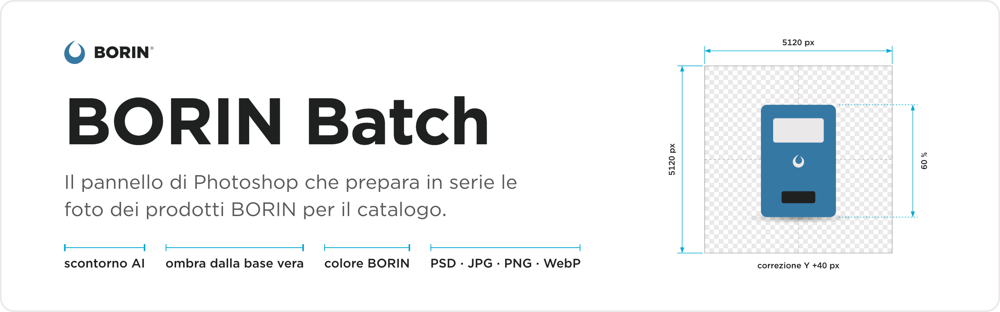

<picture>
  <source media="(prefers-color-scheme: dark)" srcset="immagini/banner-scuro.png">
  
</picture>

Questo repository è il **canale degli aggiornamenti** di BORIN Batch, il pannello di Photoshop che prepara in serie le foto dei prodotti BORIN per il catalogo.

**Da qui non serve scaricare niente.** Il pannello installato controlla questo canale da solo, al massimo ogni 6 ore. Quando esce una versione nuova:
1. il pannello mostra «È uscita la versione …»;
2. premi **Aggiorna adesso**;
3. chiudi e riapri il pannello.

Si può controllare anche a mano, da **Info › Cerca aggiornamenti**.

<picture>
  <source media="(prefers-color-scheme: dark)" srcset="immagini/flusso-scuro.png">
  
</picture>

## Che cosa c'è in ogni release

| File | A cosa serve |
|---|---|
| `BORIN-Batch-<versione>-aggiornamento.zip` | il pannello senza i font, per aggiornare quello già installato |
| `aggiornamento.json` | numero di versione, impronta sha256 dello zip, Photoshop minimo (2022, cioè la 23.0) |

Prima di installare, il pannello:
- controlla l'impronta e il numero di versione;
- mette da parte una copia della versione in uso;
- lascia stare i font.

## Il pannello

<picture>
  <source media="(prefers-color-scheme: dark)" srcset="immagini/pannello-scuro.png">
  
</picture>

## La prima installazione

Qui ci sono solo gli aggiornamenti. Il pacchetto completo per Mac o per Windows contiene l'installatore, la guida PDF e i font: chiedilo a chi gestisce il pannello in BORIN.

Dopo l'installazione il pannello è in **Finestra › Estensioni (precedenti) › BORIN Batch**.
