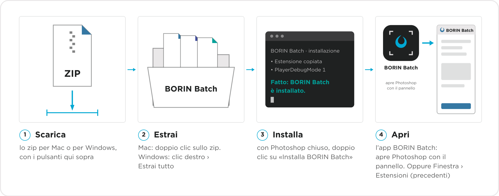
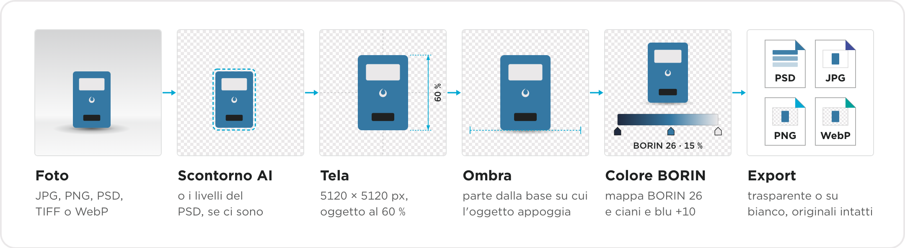
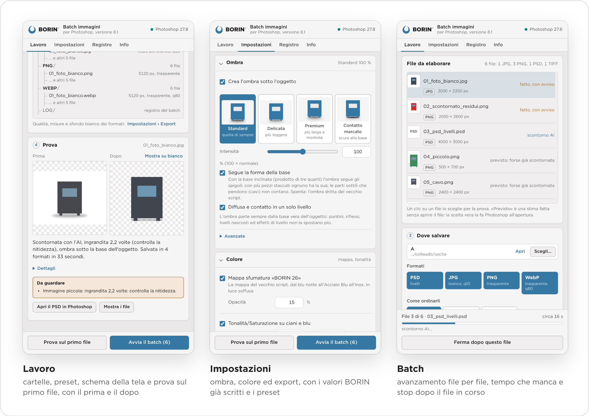

<picture>
  <source media="(prefers-color-scheme: dark)" srcset="immagini/banner-scuro.png">
  
</picture>

Da qui si scarica **BORIN Batch**, il pannello di Photoshop che prepara in serie le foto dei prodotti BORIN per il catalogo. Dopo l'installazione il pannello si aggiorna da solo, sempre da qui.

## Scaricare e installare

  
  &nbsp;
  

I due pulsanti scaricano sempre l'ultima versione. Serve Photoshop 2022 (versione 23.0) o successivo.

<picture>
  <source media="(prefers-color-scheme: dark)" srcset="immagini/installa-scuro.png">
  
</picture>

1. **Scarica** lo zip del tuo sistema con uno dei due pulsanti: finisce nella cartella Download.
2. **Estrai** lo zip:
   - Mac: doppio clic sullo zip;
   - Windows: clic destro sullo zip › **Estrai tutto**.
3. **Chiudi Photoshop**. Nella cartella estratta fai doppio clic su **Installa BORIN Batch**. Quando la finestra scrive «Fatto», premi un tasto per chiuderla.
4. **Apri l'app BORIN Batch**: sul Mac è in Applicazioni (Launchpad, Spotlight o Dock), su Windows sul desktop e nel menu Start. Apre Photoshop con il pannello già aperto. In alternativa, in Photoshop: **Finestra › Estensioni (precedenti) › BORIN Batch** (in inglese: Window › Extensions (Legacy) › BORIN Batch).

Nella cartella estratta c'è anche la **guida PDF**, con tutte le funzioni del pannello.

<b>Se il Mac non apre l'installatore</b>

Il Mac può bloccare i file arrivati da internet. Prova in quest'ordine:
1. clic destro (o ctrl + clic) su «Installa BORIN Batch», poi **Apri** e ancora **Apri**;
2. se compare solo il pulsante **Fine** (macOS 15 Sequoia e successivi): apri **Impostazioni di Sistema › Privacy e sicurezza**, scorri in fondo e premi **Apri comunque** accanto al nome del file;
3. oppure apri il Terminale (Applicazioni › Utility), scrivi `bash` seguito da uno spazio, trascina nella finestra il file «Installa BORIN Batch» e premi Invio.

Se il Mac chiede se il Terminale può accedere alla cartella Download o alla Scrivania, premi **Consenti**.

<b>Se Windows blocca l'installatore</b>

- Se compare «Windows ha protetto il PC»: premi **Ulteriori informazioni**, poi **Esegui comunque**.
- Se compare «Apri file - Avviso di sicurezza»: premi **Esegui**.
- Se l'installatore dice che non trova la cartella com.borin.batch, lo zip non è stato estratto: torna al passo 2.

Non servono i permessi di amministratore.

<b>Scaricare da GitHub senza i pulsanti</b>

1. Nella colonna a destra di questa pagina, sotto **Releases**, premi la versione segnata **Latest**.
2. In fondo alla pagina della versione, sotto **Assets**, premi `BORIN-Batch-Mac.zip` o `BORIN-Batch-Windows.zip`.

I pacchetti completi ci sono dalla versione 8.0.4 in poi.

## Aggiornamenti

Il pannello installato controlla questo repository da solo, al massimo ogni 6 ore. Quando esce una versione nuova:
1. il pannello mostra «È uscita la versione …»;
2. premi **Aggiorna adesso**;
3. chiudi e riapri il pannello.

Si può controllare anche a mano, da **Info › Cerca aggiornamenti**. Le impostazioni e i preset restano.

## Che cosa fa

<picture>
  <source media="(prefers-color-scheme: dark)" srcset="immagini/flusso-scuro.png">
  
</picture>

## Il pannello

<picture>
  <source media="(prefers-color-scheme: dark)" srcset="immagini/pannello-scuro.png">
  
</picture>

## Dove sono i file

- **`com.borin.batch/`**, nell'elenco in cima alla pagina: il pannello dell'ultima versione, file per file, senza i font.
- **Releases**, nella colonna a destra: una per versione.

| File della release | A cosa serve |
|---|---|
| `BORIN-Batch-Mac.zip`, `BORIN-Batch-Windows.zip` | il pacchetto completo per installare da zero: installatore, guida PDF e font Gotham |
| `BORIN-Batch-<versione>-aggiornamento.zip` | il pannello senza i font, per aggiornare quello già installato |
| `aggiornamento.json` | numero di versione, impronta sha256 dello zip, Photoshop minimo (2022, cioè la 23.0) |

Prima di installare un aggiornamento, il pannello:
- controlla l'impronta e il numero di versione;
- mette da parte una copia della versione in uso;
- lascia stare i font.
